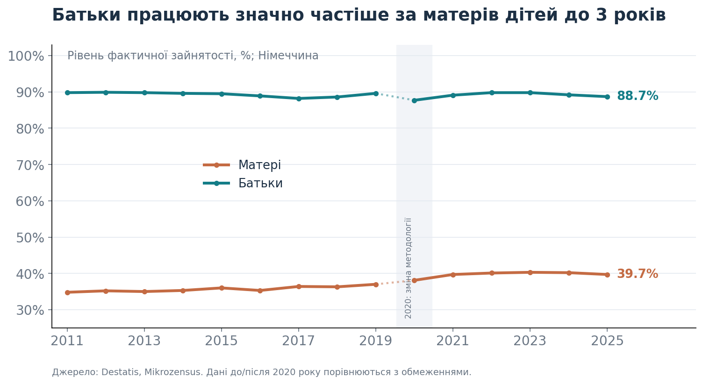
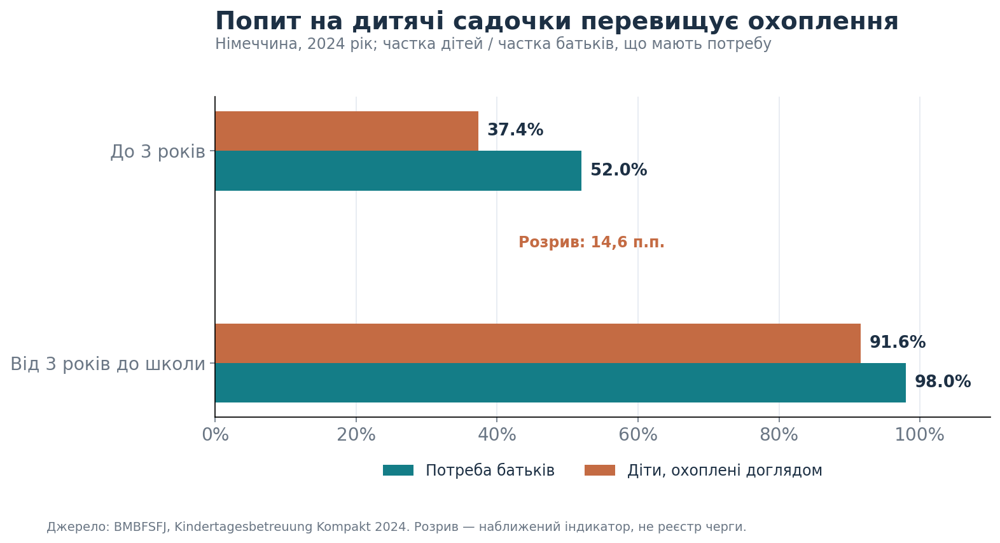
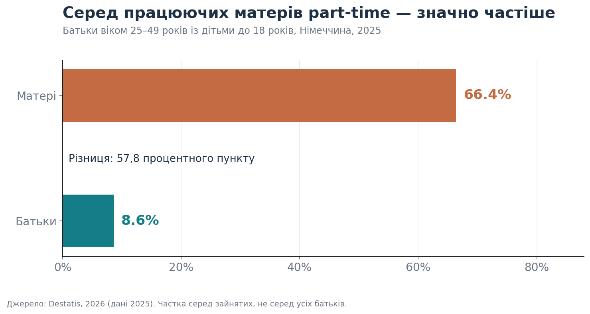

# Повернення матерів до роботи в Німеччині: де виникають бар’єри?

*Що показують державні дані про зайнятість батьків, доступність дитсадків і нерівний розподіл неоплачуваної праці.*

## Вступ: право на дитсадок ще не гарантує можливості працювати

Уявімо сім’ю, у якій дитині виповнилося три роки, а місце в дитячому садочку досі не знайдено. Один із батьків планує повернутися до роботи, але не може визначити навіть дату виходу. Це не лише побутова незручність: доступність догляду за дітьми впливає на можливість шукати роботу, погоджувати графік і відновлювати кар’єру.

У Німеччині дитина від трьох років до початку навчання у школі має законодавчо закріплене право на дошкільний догляд у закладі згідно з **§ 24 SGB VIII**. Однак існування права не означає, що в кожній громаді доступна достатня кількість місць у потрібний час. До того ж сім’ї мають враховувати години роботи закладів і вартість догляду, яка залежить від регіональних та місцевих правил. [Законодавство](https://www.gesetze-im-internet.de/sgb_8/__24.html); [федеральний огляд](https://www.bundeswirtschaftsministerium.de/Redaktion/DE/Schlaglichter-der-Wirtschaftspolitik/2024/11/06-abbau-kinderbetreuung.html).

Мета цього дослідження — **оцінити масштаби відмінностей у зайнятості матерів і батьків та перевірити, що офіційні дані говорять про можливі бар’єри повернення до роботи**. У фокусі чотири теми: дитсадки, гнучкий графік, неоплачувана праця в родині та підтримка після кар’єрної паузи.

## Що і як аналізувалося

Використано відкриті дані Федерального статистичного відомства Німеччини (**Destatis**), Федерального міністерства у справах сім’ї (**BMBFSFJ**) та інші офіційні державні джерела. Основні показники охоплюють **2011–2025 роки**, але мають різні референтні роки й визначення: зайнятість — до 2025 року, охоплення доглядом і попит — 2024 рік, part-time — 2025 рік, розподіл часу — 2022 рік.

Тут досліджуються **статистичні зв’язки й структурні відмінності**, а не причинний ефект браку садочків. Агреговані показники не дозволяють визначити, скільки конкретно матерів не можуть працювати саме через відсутність місця або як довго триває їхня кар’єрна перерва.

## 1. Зайнятість: найбільша різниця — коли діти маленькі

**Рисунок 1.** Фактична зайнятість матерів і батьків віком 15–64 роки, які проживають із принаймні однією дитиною до трьох років. Джерело: [Destatis, Mikrozensus](https://www.destatis.de/DE/Themen/Querschnitt/Gleichstellungsindikatoren/tab-erwerbstaetigkeit-eltern-f23.html).

За даними за **2025 рік**, працювали **39,7% матерів** і **88,7% батьків** із дітьми до трьох років. Різниця становила **49 процентних пунктів**. Серед батьків із принаймні однією дитиною до 18 років рівень зайнятості становив **71,2% для матерів** та **91,4% для батьків**. [Destatis](https://www.destatis.de/DE/Presse/Pressemitteilungen/Zahl-der-Woche/2026/PD26_19_p002.html).

Довший часовий ряд показує, що зайнятість матерів маленьких дітей поступово зростала порівняно з початком 2010-х, але у 2025 році залишалася набагато нижчою за зайнятість батьків. **Важливо:** починаючи з 2020 року методологію Mikrozensus було змінено, тому порівняння з попередніми роками має обмеження. Також група «батьки з дітьми до 18 років» включає сім’ї з малюками: це не спостереження за одними й тими самими людьми в часі.

**Висновок 1.** Малий вік дітей пов’язаний із набагато нижчою участю матерів у зайнятості. Проте сам показник зайнятості ще не пояснює, що саме змушує або спонукає матерів відкладати вихід на роботу.

## 2. Дитсадки: між потребою і фактичним охопленням залишається розрив

**Рисунок 2.** Частка батьків, які повідомляють про потребу в догляді, та частка дітей, які користуються ним, за віковими групами. Дані за **2024 рік**: [BMBFSFJ, Kindertagesbetreuung Kompakt](https://www.bmbfsfj.bund.de/bmbfsfj/aktuelles/pressemitteilungen/weiterhin-hoher-bedarf-an-kindertagesbetreuung-trotz-sinkender-geburtenzahlen-269144).

Для дітей **до трьох років** потребу в організованому догляді висловлювали приблизно **52,0% батьків** (розраховано як 37,4% охоплення + 14,6 п.п. розриву), тоді як охоплення складало **37,4% дітей**: розрив **14,6 п.п.** Для дітей **від трьох років до школи** потребу повідомляли **98% батьків**, а фактично послугами користувалися **91,6% дітей**: різниця приблизно **6,4 п.п.** Це показники для Німеччини загалом, а не для конкретної громади. [BMBFSFJ](https://www.bmbfsfj.bund.de/bmbfsfj/aktuelles/pressemitteilungen/weiterhin-hoher-bedarf-an-kindertagesbetreuung-trotz-sinkender-geburtenzahlen-269144).

У відповіді федерального уряду Бундестагу зазначено, що розрив за 2024 рік **розрахунково відповідав близько 152 тисячам місць** для дітей від трьох до шести років. Це **оцінка**, а не фактична кількість дітей у реєстрі очікування. [Deutscher Bundestag](https://www.bundestag.de/presse/hib/kurzmeldungen-1117292).

За новішими даними за **2025 рік** охоплення дітей до трьох років складало **37,8%**, за заявленої потреби **49,3%**: розрив **11,5 п.п.** Отже, нестача не зникла навіть за зниження народжуваності. Міністерство також повідомило про проблему непланових закриттів дошкільних закладів, особливо в західній Німеччині. [BMBFSFJ, 2026](https://www.bmbfsfj.bund.de/bmbfsfj/themen/familie/kita-bedarf-bleibt-trotz-sinkender-geburtenzahlen-hoch-289734).

**Висновок 2.** Національна статистика підтверджує, що незадоволена потреба в дитячому догляді — не лише окремі історії сімей. Водночас **розрив між бажаним і фактичним охопленням не можна ототожнювати з точною кількістю відмов у місці**: обстеження, вікові групи, години догляду та місце проживання мають значення.

## 3. Навіть за наявності роботи матері частіше працюють part-time

**Рисунок 3.** Частка part-time серед **зайнятих** матерів і батьків **віком 25–49 років** із дітьми до 18 років, **2025 рік**. Джерело: [Destatis](https://www.destatis.de/DE/Presse/Pressemitteilungen/2026/05/PD26_N035_13.html).

У 2025 році **66,4% працевлаштованих матерів** із дітьми до 18 років працювали неповний день. Серед працевлаштованих батьків таких було лише **8,6%**. Різниця — **57,8 процентного пункту**. Це різні частки *серед тих, хто має роботу*, а не показники зайнятості всього населення.

Part-time може бути добровільним і корисним варіантом суміщення професійного та сімейного життя. Однак за потреби збільшити зайнятість невідповідність графіка садочка і роботи може обмежувати вибір. Сам факт роботи неповний день не доводить вимушеності такого рішення.

**Висновок 3.** Повернутися до будь-якої роботи — не те саме, що мати можливість працювати стільки годин, скільки людина хоче або потребує.

## 4. Що ще може впливати на повернення до роботи?

### Розподіл догляду за дітьми та домашньої праці

Офіційне дослідження використання часу **2022 року** показало, що матері в сім’ях із дітьми в середньому витрачали **39 годин 56 хвилин на тиждень на неоплачувану працю**, тоді як батьки — **25 годин 22 хвилини**. Різниця становить **14 годин 34 хвилини на тиждень**. При цьому сумарний час оплачуваної та неоплачуваної праці в матерів і батьків був майже однаковим. [Destatis, ZVE 2022, перегляд 2025](https://www.destatis.de/DE/Themen/Gesellschaft-Umwelt/Einkommen-Konsum-Lebensbedingungen/Zeitverwendung/Tabellen/arbeit-muetter-vaeter-zve.html).

Ці дані не вимірюють безпосередньо повернення після декрету, але показують суттєву нерівність у розподілі часу. Вона може обмежувати можливості професійного навчання, пошуку роботи та збільшення робочих годин.

### Гнучкий графік і передбачуваність догляду

Гнучкий початок робочого дня, дистанційна робота там, де вона можлива, або поступове збільшення навантаження можуть полегшити повернення. **Bundesagentur für Arbeit** прямо називає part-time, Gleitzeit та Homeoffice серед моделей, які можна обговорити з роботодавцем. Але у використаному наборі даних **немає оцінки того, скільки матерів позбавлені такої можливості**. Тому це практична гіпотеза й напрям для подальшого дослідження, а не доведена причина статистичного розриву. [BA](https://www.arbeitsagentur.de/karriere-und-weiterbildung/zurueck-ins-berufsleben).

### Професійне повернення після тривалої перерви

Після сімейної паузи можуть змінитися вимоги до навичок, робочі інструменти й очікування роботодавців. Федеральна служба зайнятості пропонує консультування з **Wiedereinstieg**, зміни професії та підвищення кваліфікації. Однак наші агреговані дані не показують, які саме бар’єри — відсутність садочка, невідповідний графік чи навички — є найбільш поширеними серед кандидаток після перерви. [BA](https://www.arbeitsagentur.de/karriere-und-weiterbildung/zurueck-ins-berufsleben).

### Вартість садочка: важливе питання, але без узагальнення

Плата за дитячі садочки залежить від земель і муніципалітетів, а не встановлюється єдиним тарифом для всієї Німеччини. Тому інформацію про підвищення внесків у певній громаді **не можна автоматично поширювати на всю країну**. Щоб оцінити економічний вплив, потрібні окремі дані про місцеві тарифи, доходи сімей та необхідну кількість годин догляду. [Федеральне міністерство економіки](https://www.bundeswirtschaftsministerium.de/Redaktion/DE/Schlaglichter-der-Wirtschaftspolitik/2024/11/06-abbau-kinderbetreuung.html).

## Рекомендації: кому і що можна запропонувати

**Муніципалітетам і земельним органам, відповідальним за догляд:** публікувати прості показники очікування місця, потреби за віком дітей, кількості вільних місць, доступних годин і непланових закриттів. Оцінювати не лише формальну наявність садочка, а й **доступність потрібного графіка**. Для сімей із дітьми від трьох років це особливо важливо на тлі законодавчого права на догляд.

**Роботодавцям:** запроваджувати реалістичні сценарії повернення після сімейної паузи: гнучкий старт робочого дня, перехід від part-time до більшої зайнятості за бажанням працівниці, returnship-програми та навчання з урахуванням потреб догляду. Оцінювати результат не лише за кількістю найнятих людей, а й за утриманням та добровільним збільшенням годин.

**Bundesagentur für Arbeit та регіональним центрам зайнятості:** поєднувати консультації з Wiedereinstieg із перевіркою реальної доступності догляду та графіка, а також із короткими програмами оновлення професійних навичок. Для оцінювання ефективності відстежувати працевлаштування через 3–6 місяців і задоволеність запропонованими робочими годинами.

**Для подальшого дослідження:** окремо перевірити зв’язок місцевих тарифів і доступності дитсадків із зайнятістю матерів, бажаною кількістю годин і тривалістю кар’єрної перерви. Для висновків про причини потрібні дані на рівні сімей/регіонів та належний статистичний дизайн.

## Висновки

Офіційна статистика Німеччини підтверджує три важливі проблеми. **По-перше**, у 2025 році зайнятість матерів із дітьми до трьох років була на **49 п.п.** нижчою, ніж батьків. **По-друге**, потреба в дошкільному догляді в 2024 році перевищувала фактичне охоплення навіть серед дітей від трьох років, які вже мають законодавчо закріплене право на місце. **По-третє**, у 2025 році матері, які працювали, набагато частіше за батьків обирали неповну зайнятість, а дані про використання часу свідчать про нерівний розподіл неоплачуваної праці.

**Головний висновок:** бар’єри повернення матерів до роботи варто розглядати як поєднання умов дитячого догляду, розподілу сімейного часу і можливостей на ринку праці. Це не доказ, що кожна з цих обставин спричиняє конкретний відсоток незайнятості; це аргумент на користь більш адресних даних і практичних рішень. Наявність вакансій сама по собі не гарантує, що мати маленької дитини зможе ними скористатися.

## Джерела та методологічні примітки

1. **Destatis.** [Рівень зайнятості матерів і батьків із дітьми до трьох років, 2011–2025](https://www.destatis.de/DE/Themen/Querschnitt/Gleichstellungsindikatoren/tab-erwerbstaetigkeit-eltern-f23.html). Джерело даних графіка 1; перелом методології Mikrozensus у 2020 році.
2. **Destatis.** [Зайнятість матерів і батьків, 2025](https://www.destatis.de/DE/Presse/Pressemitteilungen/Zahl-der-Woche/2026/PD26_19_p002.html). Показники за віком дітей і визначення «фактичної зайнятості».
3. **BMBFSFJ.** [Kindertagesbetreuung Kompakt: охоплення і потреба, 2024](https://www.bmbfsfj.bund.de/bmbfsfj/aktuelles/pressemitteilungen/weiterhin-hoher-bedarf-an-kindertagesbetreuung-trotz-sinkender-geburtenzahlen-269144). Джерело графіка 2; розбіжності у показниках округлені.
4. **BMBFSFJ.** [Kindertagesbetreuung Kompakt: дані за 2025](https://www.bmbfsfj.bund.de/bmbfsfj/themen/familie/kita-bedarf-bleibt-trotz-sinkender-geburtenzahlen-hoch-289734). Оновлення щодо дефіциту місць та надійності послуг.
5. **Destatis.** [Часткова зайнятість матерів і батьків, 2025](https://www.destatis.de/DE/Presse/Pressemitteilungen/2026/05/PD26_N035_13.html). Джерело графіка 3; лише працюючі батьки 25–49 років.
6. **Destatis.** [Time Use Survey (ZVE), 2022, переглянуті дані](https://www.destatis.de/DE/Themen/Gesellschaft-Umwelt/Einkommen-Konsum-Lebensbedingungen/Zeitverwendung/Tabellen/arbeit-muetter-vaeter-zve.html). Час на оплачувану та неоплачувану роботу, інша вибірка і рік, ніж у показниках зайнятості.
7. **Deutscher Bundestag.** [Оцінка нестачі місць у дитсадках, 2024](https://www.bundestag.de/presse/hib/kurzmeldungen-1117292). Розрахункова, не адміністративно зафіксована нестача.
8. **Німецьке законодавство.** [§ 24 SGB VIII: право на дошкільний догляд](https://www.gesetze-im-internet.de/sgb_8/__24.html).
9. **Bundesagentur für Arbeit.** [Повернення до професійної діяльності після перерви](https://www.arbeitsagentur.de/karriere-und-weiterbildung/zurueck-ins-berufsleben). Практичні заходи підтримки.
10. **Федеральне міністерство економіки.** [Економічне значення доступу до догляду за дітьми](https://www.bundeswirtschaftsministerium.de/Redaktion/DE/Schlaglichter-der-Wirtschaftspolitik/2024/11/06-abbau-kinderbetreuung.html). Роль земель і муніципалітетів у фінансуванні й оплаті догляду.

*Дата підготовки: 6 листопада 2026 року. Цей матеріал є описовим навчальним аналізом агрегованої офіційної статистики. Різні вибірки, роки й визначення показників не можна інтерпретувати як індивідуальні траєкторії матерів після декрету. Статистична асоціація не доводить причинно-наслідковий зв’язок.*

---

## Вміст репозиторію / Repository contents

- `README.md` — повний текст аналітичного дослідження українською мовою.
- `Observer_Article.md` — версія статті для редакційної публікації.
- `Observer_Article.html` — HTML-версія для CMS (зображення треба завантажити в медіатеку).
- `Observer_Article.pdf` — PDF для перевірки/здачі.
- `charts/` — три графіки у форматі PNG для Observer або іншого CMS.
- `data/` — первинні агреговані офіційні показники, використані для графіків, у форматі CSV, і реєстр джерел.
- `Google_Sheets_Analysis.xlsx` — структурована книга з даними, формулами та джерелами, сумісна з імпортом у Google Sheets.
- `Methodology.md` — обмеження дослідження, визначення метрик і спосіб відтворення.

**Інструменти:** Google Sheets / Excel-сумісна таблиця; графіки підготовлені програмно на основі тих самих перевірених показників для якісного відображення в статті.

**Статус:** навчальний дослідницький проєкт, не рецензоване наукове дослідження.
